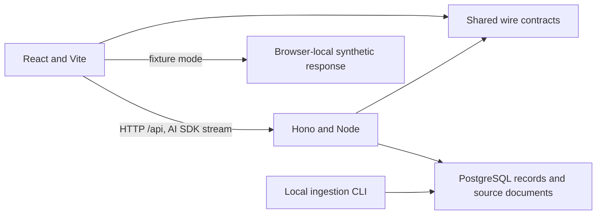

# Architecture and ownership

## Product target

Build the operator copilot described in the [challenge index](problem-statement/index.md).
It must join numeric records and document rules, explain findings with citations,
render suitable inline visuals, share well knowledge/corrections across users, and
keep each user's conversation history private. Sample expectations are evaluation
targets, not hardcoded answer templates.

## Workspace

| Location | Owner and responsibility |
| --- | --- |
| `apps/web/` | Frontend: Vite-generated React/TypeScript app, TanStack Router/Query, chat client, visual renderers and browser fixtures |
| `apps/api/` | Backend: Hono/Node HTTP service; agent foundation; PostgreSQL connection/evidence access; future calculations, corrections and memory |
| `apps/ingestion/` | Backend: independent local directory loader with transactional PostgreSQL writes |
| `packages/db/` | API-owned, server-only Drizzle schemas, migrations and client shared with ingestion |
| `packages/contracts/` | Coordinated shared Zod schemas, wire types and synthetic data fixtures |
| Root configs and lockfile | Shared workspace infrastructure; update intentionally across branches |

Turborepo coordinates tasks and caching over pnpm workspaces. The official Turbo
starter's Next apps and example UI/config packages are absent from this workspace.
The web was generated with `create-vite@9.2.1 --template react-ts` and then adapted.
Biome and TypeScript defaults live at the root; no separate shared config packages.

## Boundaries

The frontend owns navigation, UI state, charts/maps/cards, chat rendering and ordinary
API cache. AI SDK UI owns live chat message state; TanStack Query owns ordinary
queries/mutations. Use contracts, not API source imports, to integrate with the backend.

The backend owns evidence selection, calculations, model/tool execution and durable
state. Directory ingestion has its own CLI boundary in `apps/ingestion`, independent
of the HTTP server. Keep app-specific logic local and extract shared storage code only
when both applications consume it. Neither application imports the other's source.
See the [boundary decision](decisions/001-independent-ingestion-cli.md) for the rationale.
Canonical storage uses PostgreSQL with Drizzle; the API owns schemas/migrations and
ingestion owns directory reading, validation and writes through `packages/db`.
See the [storage decision](decisions/003-postgres-drizzle-storage-ownership.md) for
evidence, ownership and remaining implementation work.

The shared package defines what crosses the wire, not how answers are calculated.
Add a second shared package only for concrete reuse. UI components stay in the web app.

## What exists now

- App-independent dev/build commands and configurable ports.
- API health and a validated, bounded chat endpoint returning synthetic AI SDK messages.
- Frontend fixture/live transport selection, inline status-card rendering and evidence.
- Root/local agent instructions, pinned dependencies, formatting/types and basic CI.

PostgreSQL persistence and a local ingestion CLI are available; see [storage setup](storage.md).
There is no model integration, persistent chat, private/shared memory, user picker,
authentication or full visual catalog yet. The demo's user ID
and conversation ID are fixture identifiers. The backend must replace that boundary
appropriately before it serves private data. Stream results and renderers should be
persistable when memory is implemented.

## Agent runtime decision

The user selected AI SDK and confirmed this worktree is backend-only. Frontend
implementation remains in the other worktree. Shared schemas and fixtures are a
coordination boundary; stop and hand off when renderer or other frontend changes are
needed. See the [runtime and delivery decision](decisions/002-ai-sdk-runtime-and-backend-boundary.md)
for the rationale, unresolved choices and generative UI contract expectations.

## Runtime direction

Build the SPA into static files and the API into a Node entrypoint. A production
reverse proxy should serve the SPA and route `/api/*` to Hono on one browser origin,
preserving streaming and cancellation. Vite's proxy is development-only; Vite preview
is a local build inspection tool. PostgreSQL and Drizzle are selected; hosting, database provider and model selection remain open.

Both branches prioritize speed. Add tests only when necessary and important for
setup or critical behavior; do not create new suites to validate routine scaffolding.
