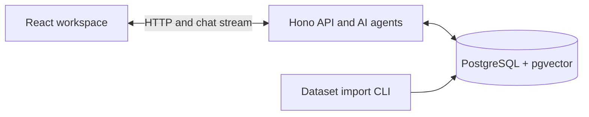
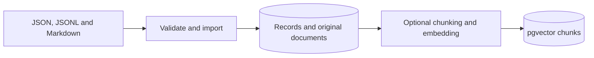
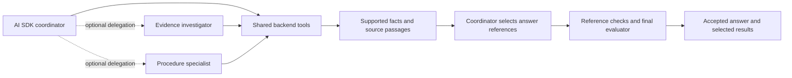
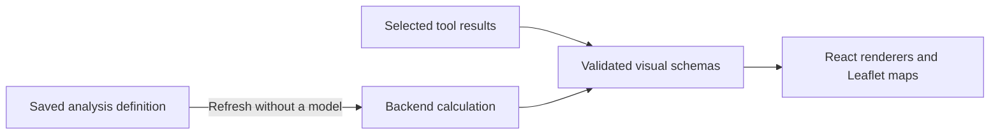

# Fieldwork Asset Intelligence Copilot

## What we built

Fieldwork helps oil-field operators ask questions about wells, production, spills, repairs and operating procedures. Answers combine inspection data, manuals, SOPs, maintenance reports, regulatory records and human notes. Users can open the supporting sources, view charts and maps, and save supported analyses for later refresh.

## Technologies and boundaries

| Layer | Technologies and responsibility |
| --- | --- |
| Frontend — `apps/web` | React, Vite, TanStack Router/Query and AI SDK React chat; Leaflet maps and approved visual renderers. |
| Backend — `apps/api` | Hono on Node.js; AI SDK `ToolLoopAgent`, evidence retrieval, calculations and application persistence. |
| Import — `apps/ingestion` | Independent directory validation, transactional imports and resumable document embedding. |
| Storage — `packages/db` | PostgreSQL, Drizzle schemas/migrations and pgvector; shared by API and importer. |
| Contracts — `packages/contracts` | Zod schemas and browser-safe message, result and visual types. |
| Models | OpenRouter chat/tool-call adapter; separate embedding requests for document indexing and optional semantic search. |

All application code is TypeScript. The browser communicates over HTTP; server implementations stay behind the API.

## How data is stored and found

The importer loads dataset folders without starting the web application. We kept it separate because importing and retrying new challenge data has a different lifecycle from answering chat requests.

Records, documents and vectors live in the same PostgreSQL database. The API uses exact reads and SQL calculations, plus full-text and optional vector search for document discovery.

**Why PostgreSQL:** our dataset audit found consistent records and clear links between wells, inspections, repairs and reports. Database constraints enforce these links, while SQL supports exact totals and date filters. We retain original files, raw records, decimal values and source locations so answers can be checked against their evidence.

The assistant finds information in three ways:

- **Direct reads** follow record IDs and stored report links, and load the well’s type manual and applicable procedures.
- **Document search** uses full-text search, optionally combined with pgvector similarity search. Embeddings use `openai/text-embedding-3-small` with 1,536 dimensions. Overlapping text chunks remain tied to the original document version. Full-text search still works if semantic search fails.
- **Calculations** use all matching structured records before limiting displayed rows. Search results are useful for finding explanations; they cannot establish complete fleet totals.

Keeping records and document search in PostgreSQL avoids maintaining a separate vector database for this POC.

## How a question becomes an answer

The API loads server-owned conversation history and starts the coordinator. Agents share backend services; they do not maintain separate copies of the data.

The coordinator uses tool results to decide its next step. The final evaluator can request a revision before publication.

| Role | Responsibility |
| --- | --- |
| Coordinator | Plans scope, dates, question parts and output; calls tools, optionally delegates, and selects facts for publication. Maximum 12 steps. |
| Evidence investigator | Investigates records, linked reports and calculations; returns cited findings and uncertainty. Maximum five steps. |
| Procedure specialist | Reads applicable and inherited procedures, connects incident evidence to supported clauses, and reports missing evidence. Maximum five steps. |
| Final evaluator | Checks the proposed answer against the latest request, scope and requested visuals. Can request revision; at most two evaluations per turn. |

Specialists are optional for simple questions and cannot publish the final answer or delegate further.

### Tools used by the agents

| Purpose | Implemented tools |
| --- | --- |
| Plan and clarify | `validateQuestion`, `describeMetric`, `explainCapability` |
| Resolve wells and context | `listAssets`, `locateAssets`, `getOperationalContext` |
| Read evidence | `readRecord`, `readEvidence`, `searchEvidence`, `getApplicableProcedures`, `getOperationalRecords` |
| Calculate metrics | `analyzeAssetOperations`, `analyzeAreaOperations`, `analyzeFleetOperations` |
| Trace incidents and rules | `traceRelationships`, `assessIncidentTimings`, `assessDeadline`, `calculateDeadline` |
| Delegate investigations | `investigateEvidence`, `assessProcedures` |
| Inspect and publish | `inspectResult`, `citePassage`, `presentResult`, `publishAnswer` |
| Reuse earlier views | `listConversationComponents`, `reuseViewComponents` within the current conversation |

### Calculations and answer checks

The backend owns the calculations:

- **Production:** compare wellhead minus ambient temperature with the threshold in the applicable manual.
- **Downtime:** count seven days per non-producing inspection.
- **Spills:** exclude supported formal false positives and show the correction evidence.
- **Repair costs:** sum exact recorded amounts, selecting jobs by work start date.

Development trials showed that correct tool results could still become misleading prose. We therefore changed publication: the model selects backend-generated facts and exact source passages, and the server assembles the answer. A final model check reviews relevance, scope and completeness. Reference checks bind answers and visuals to actual results. Each domain operation uses a short Repeatable Read transaction and retains inputs, units, coverage, warnings and source references; this is consistency per operation, not a historical snapshot of the whole run. Unsuccessful publication produces an explicit limitation. These checks reduce unsupported claims; they do not prove source observations are true.

## Visuals and saved analyses

The UI supports status cards, tables, bar charts, temperature lines, maps and heatmaps. The model selects a presentation; backend results supply its values. Users can inspect sources and reuse compatible views within a conversation. Zod contracts validate the result shapes; the model does not generate executable UI code. AI SDK UI messages stream application progress and results, while the current provider adapter returns complete model responses.

Supported saved analyses retain their filters and calculation definition. Refresh runs the backend calculation without calling a model. Saving is available only where the executed analysis can be represented by an approved definition; asset-location maps currently lack this support.

Both chat results and saved-view refreshes use backend values and the same approved renderers.

## Memory, corrections and new data

**Shared knowledge:** imported notes, feedback, procedures and corrections are available across users. Notes retain authors and dates. Conflicting claims remain attributed rather than silently replacing observations. Supported imported spill corrections change subsequent totals while preserving the original detection. Chat cannot yet write shared corrections or rules, or apply arbitrary numerical overrides.

**Private memory:** conversations, results and saved views persist per user. The server checks ownership and supplies recent history and retained view references within the current conversation. General recall across separate chats is incomplete. The demo user picker provides private workspaces, not production authentication or role-based permissions.

New datasets use the same importer. Repeated identical records are safe to load; conflicting existing records are rejected. Embedding runs after import and can resume after failure. The final dataset is loaded in a separate validation database; its question accuracy still requires evaluation.

## Models, cost and next steps

The code defaults to `anthropic/claude-haiku-5.5` through OpenRouter, with separate model settings for the coordinator, specialists and final evaluator. Tool loops are bounded, and routine reads and saved-view refreshes avoid model calls.

One recorded 11-trial development round cost approximately **$0.056 for successful candidate responses**. This excludes debugging, embeddings, failed calls and the later runtime evaluator, so it is not the total project cost or a complete per-question estimate.

Next steps are shared correction and rule writes with an audit trail, exact cross-chat private recall, broader procedure and historical-change handling, and final-question evaluation. Production use also requires real authentication and authorization.
