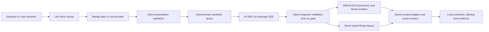

# Lab architecture

The application matches the real UI stack: React 19.3.1, Vite 8.3.4, TanStack Router 1.170.45, Query 5.104.3, AI SDK 7.0.143 and `@ai-sdk/react` 4.0.147. The separate demo backend matches Hono 4.13.13 / Node 22.22.3. No production source is imported.

## File boundaries

| File | Responsibility |
| --- | --- |
| `server/domain.ts` | Synthetic observations, evidence, deterministic production/downtime and initial compositions |
| `server/provider.ts` | Server-only compatible provider adapter, timeout, bounded response and strict plan parsing |
| `server/app.ts` | Hono request boundaries, replay/live selection and AI SDK stream |
| `src/protocol.ts` | Browser-safe schemas, permitted queries/views, canonical A2UI wire construction, snapshot validation and cancellation run gate |
| `src/renderers.tsx` | Official A2UI catalog/processor/surface and direct baseline |
| `src/widgets.tsx` | Cards, table, line/bar charts, coordinate map, heatmap, conflicts and shared interaction context |
| `src/App.tsx` | Conversation/canvas shell, AI SDK chat, Query health, experiment controls, local persistence and export |
| `src/main.tsx` | TanStack Router and Query providers |
| `scripts/dev.mjs` | Starts and stops only the lab's web/API processes |

The root route is deliberately small. TanStack Query owns ordinary health/config availability; `useChat` owns streamed conversation state. A separate validated snapshot owns the visible canvas so malformed chat data does not erase useful content.

## Generation versus authority

A presentation plan contains exactly a supported query and a unique ordered view list. The server computes production using temperature difference and the synthetic type rule, and downtime from observed weekly readings. A missing inspection adds no downtime. Spill event dates, coordinates, units, original/corrected observations and evidence remain part of the result.

Views resolve `resultId` through the application context; a model cannot supply numeric props to overwrite records. The `DataView` catalog entry accepts only a supported kind and a result-handle binding. The `Column` entry reuses A2UI's standard component API with a React layout implementation.

This is a deliberately bounded presentation experiment. It is not a retrieval agent, a general query planner, an ingestion pipeline or a formal A2UI conformance suite.

## A2UI lifecycle

Pinned packages: `@a2ui/react` and `@a2ui/web_core` **0.14.0**. Wire protocol: **v0.9.1**, imported through their `v0_9` entrypoints. Package version and protocol version are different. Installed declarations explicitly include v0.9.1.

1. Create a uniquely identified surface with the lab catalog.
2. Bind `/resultId` through `updateDataModel`.
3. Send a valid root and the first two view components.
4. Update the root/components with the full chosen composition.

The client retains canonical message history for replay, applies only the unseen suffix to a persistent processor and routes A2UI actions through the application's interaction handler. Stable view IDs prevent duplicate widgets. Switching renderer retains the application-owned filter/selection/draft context.

Only the lab's constrained canonical message subset is admitted. This makes arbitrary function calls, unexpected data bindings, arbitrary children and generated executable content unreachable. A generic A2UI composition authoring tool is not implied.

## Updates, failure and persistence

Each request has a run ID. The run gate accepts events only for the active run. Stop invalidates that run before aborting transport; the last completed snapshot is restored. Invalid components, results, sources or partial envelopes are rejected before reaching either renderer. A renderer error boundary contains unexpected React failures.

Only complete validated snapshots are stored under `genui-lab-investigation-v1`. Restoration checks the storage envelope version and the full snapshot again. This is synthetic browser-local replay, not durable shared/private enterprise memory. Local observation drafts survive view updates but are neither persisted nor exported.

A representation change reuses the query/result identity and does not call the model. Area filtering and evidence selection are local projections; no production correction is submitted.

## Transport and API

- `GET /api/health`: status, synthetic flag, protocol/catalog version and live-configured boolean; no secret values.
- `POST /api/chat`: scoped lab configuration plus SDK messages, at most 64 KiB / 30 messages. SDK validates message structure.
- `data-progress` parts are transient; `data-surface` parts update a stable part ID inside the AI SDK UI-message SSE stream.
- The custom snapshot contains the result, presentation plan, provenance mode, phase and canonical A2UI history.

The demo API checks browser origins, binds loopback, bounds requests/provider responses and uses a timeout/abort signal. It is a local experiment, not an authenticated production endpoint. Never expose it publicly with configured provider credentials.

## Primary references

- [A2UI renderer matrix](https://a2ui.org/reference/renderers/)
- [A2UI client setup](https://a2ui.org/guides/client-setup/)
- [A2UI 0.9.1 specification](https://a2ui.org/specification/v0.9.1-a2ui/)
- [AI SDK custom data streaming](https://ai-sdk.dev/docs/ai-sdk-ui/streaming-data)

The installed package declarations/source were inspected in addition to these living docs; the high-level setup guide's hook/component names differ from the newer installed v0_9 exports.

Request scope: the transport sends only the latest user text and current investigation query, excluding accumulated visual/result message parts. This keeps requests bounded across repeated experiments and prevents presentation artifacts from becoming model instructions. The displayed local chat is not persistent conversational memory.

## Operator history and context

`src/history.ts` owns version-2 browser-local investigations, complete conversation entries, validated completed snapshots and answer links keyed by run ID. `App.tsx` uses AI SDK `useChat` for the current stream only. It sends the current text and explicit application context, not old visual artifacts. Scope is descriptive: area filters local views and well selection focuses the trend; domain results/answer summaries still cover the six-well fixture. No model-calculated scoped metrics.

A pending `{threadId, runId}` and run gate route validated stream events to the initiating investigation. Switch/new/Stop invalidates the gate, marks the attempt and discards partial preview. Only a ready snapshot can complete/save an answer. Historical navigation changes the active stored snapshot without a request; refresh appends a separate answer. The official renderer/direct baseline share the same trusted widgets and result reference.

History persistence is a synthetic browser experiment. On reload pending entries become interrupted. Invalid history is retained and blocks overwriting until recovery; blocked/quota-limited storage is visibly temporary. There is no server history, identity, synchronization or enterprise retention guarantee.

## Answer versus workspace activation

Completing a streamed answer saves its snapshot regardless of whether it becomes the active view. `completeAnswer(..., activate)` leaves `activeResultId` unchanged for ordinary follow-up results when a workspace already exists. Initial result, explicit refresh and representation actions activate on completion. Partial updates only preview an otherwise empty workspace. Keeping the existing snapshot reference/run key avoids remounting the renderer for chat-only or offered-result responses.

`followups.ts` provides three deliberately bounded synthetic snapshot explanations. They read selected-well fields and source IDs, append entries with `contextResultId`/`sourceIds`, and create no surface. These stored references are revalidated during history restoration. The evidence dialog can resolve that context snapshot independently of the visible canvas. Future general agent replies require a backend response-intent contract; this local helper is an evaluation affordance, not production reasoning.

## Alternative continuous page

TanStack routes `/` to the split shell and `/conversation` to the same App controller with a continuous shell. `ContinuousChat.tsx` renders immutable answer snapshots in their originating messages using the existing official A2UI/direct renderer and widgets. Pending previews are per-turn, with partial→ready updates on the same run key. Earlier completed renderers remain mounted while later turns arrive. Separate local provider state per inline result coordinates that result's table/map/trend without changing other answer controls.

Result actions pass their snapshot run ID to context/evidence handlers. Follow-up context is an explicit thread active-result/area/well tuple; source dialogs resolve exact snapshots independently of that tuple. Current scope persists at thread level, while non-focused per-result filter state remains session-local. The controller/transport, fixtures, API and shared contracts are not duplicated. Both shells share a single composer implementation and saved-history schema.

## Final operator route and saved read execution

`/operator` uses continuous inline answers with its own `fieldwork-operator-chats-v1` history. `src/view-contract.ts` defines the versioned approved read recipe; `src/useSavedViews.ts` validates separate `fieldwork-saved-views-v1` definitions/last runs. `SavedViewUI.tsx` owns explicit save and parameter drafts. `server/operator.ts` executes fresh fixture reads. `POST /api/saved-view-runs` validates definition, parameters and run ID, returning a ready snapshot with execution metadata. Production must resolve an authorized backend definition rather than trust a posted browser recipe.

Ordinary unsaved operator questions always use `/api/chat`; text-only `data-answer` responses carry their exact fresh evidence snapshot without adding a visual. Named saved invocation and direct controls share the saved-read executor. Run IDs and abort controllers reject superseded results. Draft inputs do not relabel completed data; errors retain the previous completed result. Saved runs retain composition but never replay prior narrative.

The earlier three-query schemas are fixture-specific. The [production direction](product-architecture.md) requires general investigation, retrieval, calculations, compliance, corrections and scoped memory, with broader typed artifacts. [Example questions are minimum capabilities](scenario-coverage.md), not fixed routing cases or proof that this demo answers them.

## Typed operator artifacts

`src/artifact-contract.ts` adds eight strict artifact kinds under optional Result.artifacts; result validation binds sources and well scope. `server/artifacts.ts` produces dedicated synthetic records for each read. `OperationalArtifacts.tsx` renders seven kinds; lazy `GeographicArtifact.tsx` renders Leaflet geography. Existing A2UI/direct catalog entries dispatch these through `OperationalView`; no second rendering protocol. New costs/obligations/timeline/claims/correction view kinds preserve read-recipe meaning across saved runs. Operator live provider instructions include the expanded view catalog; comparison instructions remain unchanged.

`src/backend-handoff-contract.ts` is a proposed production envelope with evidence revisions, provenance, freshness/completeness and a literal read-only boundary. It is not the active API or an actual shared-package export. `scripts/validate-backend-handoff.ts` verifies the eight concrete examples and negative trust cases. See backend-handoff.md before porting to the real apps.
