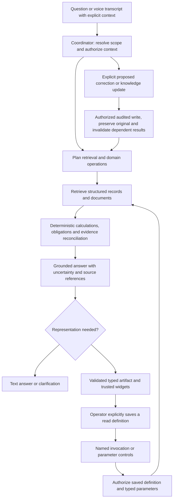

# Product architecture and minimum capabilities

Status: production direction, not implemented backend functionality. This isolated lab evaluates interaction and rendering. The actual application and its API/contracts remain untouched.

The [example questions](../../../docs/problem-statement/example-questions.md) are a **minimum capability set**, not an intent catalog, prompt router or golden-answer dataset. Different wells, dates, question wording, combinations and unseen records must work. Never embed expected answers, sample IDs or question-number branches in production logic. The demo's three-query enum, regular-expression parameter extraction, six wells and bounded provider prompt are disposable fixture adapters, not production interfaces.

## One investigation pipeline, optional read reuse

An unsaved question always traverses the investigation pipeline, even if a similar question was asked before. This does not require inventing a new layout or bypassing ordinary retrieval caches on every turn. Text alone is a valid result. Append a new visual only when it materially helps; keep earlier result versions and their sources stable.

A saved definition stores a versioned composition, allowlisted read recipe, typed parameters and defaults. A run stores parameter values, evaluation time, source revisions, rule versions and results separately. Opening, applying controls and explicit named invocation use the same authorized executor. An unrelated or extended question returns to the coordinator. Save is explicit, never inferred from reuse. Writes and unsupported analytical extensions cannot be replayed through a saved read recipe. Refresh recomputes fresh data; old narrative does not transfer to a different well.

## Responsibilities

| Layer | Responsibility |
| --- | --- |
| Backend coordinator | Resolve user intent, entities, temporal scope and private conversational references; choose tools dynamically; clarify missing scope; select answer-only versus artifact output. No question-number routing. |
| Backend retrieval | Query inspections, maintenance, spills, coordinates, manuals/SOPs, regulator records and human notes with record/page provenance. Search document narrative as well as structured fields. Return absence and uncertainty explicitly. |
| Backend domain operations | Temperature difference and type-specific rules; weekly inspection downtime; date-window aggregation/ranking; currency/costs; obligations, deadlines and regulatory reporting. Source rules from applicable versioned manuals/policies; preserve policy scope and attribution. |
| Backend knowledge and writes | Immutable original records plus attributed correction overlays; distinguish accepted corrections from disputed notes; retain conflicting claims. Audited writes and dependency invalidation/recomputation. Shared facts and policies are separate from user-private conversation history. |
| Backend identity/persistence | Authorize records, saved definitions and shared/private memory on every read/write. Resolve “we discussed yesterday” only within the requesting user's permitted history. Browser picker/local storage is not identity or enterprise persistence. |
| Shared wire contract, coordinated with backend | Versioned answer/result envelopes: run/context IDs, text, typed artifacts, units/series, evidence, scope and as-of time, uncertainty/conflicts, action proposals and execution status. Additive schemas and capability negotiation; actual shared-contract changes require coordinated implementation. |
| Frontend | Immutable conversation turns, sources linked to exact result versions, text/clarifications, typed trusted renderers, explicit save, drafts versus applied parameters, freshness/error states, proposed-action review and clear correction attribution. No domain truth or model-generated executable code. |

An answer can include multiple artifacts, or none. Data contracts must support tables, multiple named time series with units and event markers, ranked bars, geographic events, two-dimensional heatmaps and obligation/action tables. Include explicit null/missing data, correction provenance and conflicting claims. Do not force every domain result into a well-status snapshot. Generated composition is validated separately from backend-owned result values, regardless of AI SDK, A2UI or a later renderer choice.

## Generalization and acceptance

Use the [capability matrix](scenario-coverage.md) to identify gaps, then test paraphrases, unseen entities, new date windows, different types/thresholds, missing records, conflicting evidence and combinations of capabilities. Evaluate factual accuracy, source grounding, privacy, correction propagation, requested representation and understandable uncertainty separately from visual polish. Do not score hardcoded sample answers as agent capability.

Keep stateful sequences isolated and reset baseline data between independent cases. Corrections must propagate to new calculations, saved-view runs and other authorized users without silently rewriting historical answer snapshots. Show that older answers are superseded/stale when affected. Private references must never leak across users. On a failed refresh, retain the completed result's original labels/time; never relabel old values with pending parameters.

## Demonstrated here versus still required

The `/operator` demo demonstrates continuous inline visuals, browser-local chat history, explicit saved read definitions, fresh deterministic Hono fixture reads, parameter controls, source links, answer-only follow-ups and retention of completed results through loading/errors. Browser history and saved definitions are separate stores. All outputs remain synthetic.

It does **not** implement real sample-data ingestion, general tool planning/retrieval, compliance evaluation, audited corrections, multi-user identity, shared/private persistent memory, arbitrary multi-series contracts or production saved-definition authorization. A live composition provider still chooses only among fixture queries. Full example-question execution and generalization require the backend capabilities above and an expanded coordinated wire contract; no end-to-end claim is made by this frontend review.

The lab accepts a validated saved definition from browser storage for loopback synthetic experimentation. Production must load the authorized server-owned definition by ID/revision and reject unauthorized operations/parameters; client-supplied recipes are not authority.
