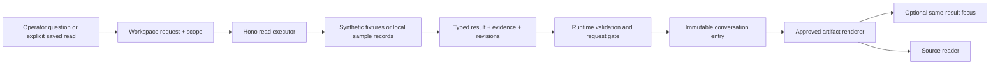

# Architecture and runtime behavior

## Boundaries

The retained demo is the only app under `experiments/`: `operator-next`. It is an independent nested pnpm workspace with its own lockfile. No source imports cross into `apps/web` or `apps/api`. `src/contracts/` is a browser-safe compatibility snapshot, not an additional shared package. Real integration must coordinate additive changes through `packages/contracts/`, with authoritative execution in `apps/api` and UI in `apps/web`.

| Layer | Source | Responsibility |
| --- | --- | --- |
| Bootstrap | `src/main.tsx` | React StrictMode, TanStack Router routes, QueryClient and bundled Manrope |
| Shell | `src/App.tsx` | Navigation, history, dataset selector, responsive sidebar and page outlet |
| Workspace authority | `src/workspace.tsx` | Request/run lifecycle, thread selection, cancellation, context, immutable responses, saved recipes, focus/evidence/save state |
| Stored state + trust gate | `src/types.ts` | Store/thread/entry schemas, interrupted-run recovery, corrupt-storage preservation and response/request correlation |
| Chat stream adapter | `src/components/AgentRequest.tsx` | AI SDK useChat/DefaultChatTransport, latest textual request, progress and verified result callbacks |
| Ordinary reads | TanStack Query in pages/focus | Dataset-bound asset directory and retry/staleness handling |
| Presentation | `src/components/WorkspaceUI.tsx`, `ArtifactView.tsx`, `GeoView.tsx` | Shell actions, typed rendering, local sort/filter/selection, evidence entry points |
| Runtime schemas | `src/contracts/index.ts`, `artifact.ts`, `visual.ts` | Response/read/saved schemas; eight artifact variants; evidence closure, geometry, date and axis constraints |
| HTTP demo | `server/index.ts`, `app.ts` | Loopback3401, Hono routes, body/origin validation, AI SDK UI-message SSE |
| Synthetic executor | `server/read.ts`, `fixtures.ts`, `fixture-snapshot.json` | Six invented wells, deterministic typed reads, fresh IDs, explicit unknowns |
| Local sample executor | `server/sample-data.ts`, `sample.ts` | Server-only dataset loading, applicable manuals, corrections, calculations, linked reports, bounded retrieval/compliance |

## Chat and result lifecycle

`POST /api/chat` accepts a request ID, typed parameters and UI messages. The demo adapter sends the latest textual request; it does not secretly implement semantic cross-chat memory. Hono resolves a bounded read, emits progress/text and `data-result`. A result can contain no visuals and still carry cited text. The app validates the response and correlation before completing the pending assistant entry. The request UUID is this demo's run correlation; result/artifact IDs are fresh per read.

Only the current request can finish its pending entry. Stop invalidates that gate before abort/unmount. Switching threads or starting a new conversation stops the old request. Reload marks interrupted work stopped, not completed. Late streams cannot attach a result to another thread. Completed evidence/results are retained with their original scope and time.

## Focus and evidence

Expand opens the existing artifact without reading again. The focused composer visibly uses that result's scope; selection can narrow it, and explicit new assets override previous context. Another answer is appended to the conversation without silently replacing the focused result. A visible return action takes the operator to the actual conversation, including when focus was opened from Saved views.

Source dialogs receive the exact result's evidence pool, never arbitrary filesystem paths. Record text is rendered as text; locators and revisions are visible. Calculations link to included inputs. ViewBoundary contains rendering failures while preserving conversation and source controls. Native dialogs provide modal focus/Escape. Chart/map modules and the chat adapter load separately.

## Explicit saved recipes

Only Save view creates a definition. The definition includes ID/revision/name, artifact kind, optional requested presentation, dataset and approved resolved parameters: well/subset/area, metric, dates, limit and relevant status/spill/obligation predicates. It contains no generated executable query, old answer or old narrative.

Opening, Apply and Refresh call `/api/views/run`, using the same read executor as chat. Current values remain labelled with their old scope during pending/failure. Apply uses draft controls only after submission; Refresh current uses the last applied response parameters. A dismissed refresh cannot reopen focus later. Explicit named reuse checks literal saved names before punctuation aliases. Unrelated or unsaved questions return to chat; repeated wording does not auto-save or bypass investigation.

Important distinctions: a filtered result set is not the original area query; save its predicate, not just today's matching wells. An obligation due date can extend past the query's event window and must not replace saved dates. A chart selected from a multi-well reply saves that chart's actual well. Costs, downtime and spill volume require separate metric bindings. Saved dataset and requested presentation must survive a fresh read.

## Data and persistence limits

`fieldwork-next-v1` local storage holds browser-local threads and recipes. Corrupt content is retained, and the new session is labelled temporary; storage failure does not claim Save succeeded. This is not authenticated enterprise memory. Old browser keys from the deleted lab are not read or silently erased.

The optional sample reader validates source records and well identities, derives temperature status from the applicable manual, applies only formal false-positive corrections and reads linked repair reports with path checks. It does not copy raw sample files into source. The current evaluation clock is the challenge's17Oct2026; timestamps and declared source periods remain visible. Sample reads are not live telemetry.

## Production work

Use the backend handoff for identity/authorization, domain tools, evidence versions, durable private history versus shared knowledge, explicit proposal/approval/commit, revision conflicts and audit. Preserve the UI contract while replacing bounded keyword routing with a real coordinator. Broaden schema limits/variants deliberately for new questions; do not coerce missing data into a chart, zero, compliance or a fabricated cause.
