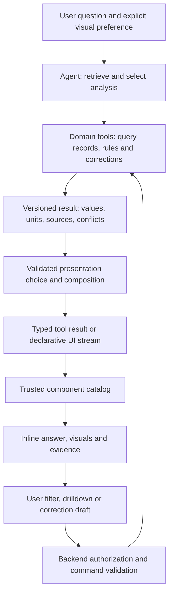

> Historical research snapshot from 17 October 2026. Preserved for technology reasoning and primary links. References to the retired lab, split-screen UX, local capture paths or an A2UI baseline are historical, not current implementation instructions. See ../decisions.md and ../architecture.md for the retained Fieldwork design. Vendor capabilities were checked at the original research date; adoption must recheck relevant versions. Raw third-party page captures are intentionally not bundled.

# Generative UI: state of the art and implications for Asset Intelligence Copilot

Research date: **17 October 2026**. This is a source-based technical assessment, not a benchmark of installed packages. Protocol status reflects the pages retrieved on this date. Recommendations below are proposals, not adopted project decisions.

## 1. What matters most

Generative UI is becoming a layered stack. Separate the model's choice of presentation, the representation it emits, the agent interaction stream, the renderer, and the application data model. Buying or adopting one layer does not solve the others.

For this copilot, the strongest starting hypothesis is **model-selected composition of trusted domain components backed by deterministic query results**. The challenge requires many questions and six visual families, but does not require generating arbitrary browser code. A generated answer can combine a chart, evidence drawer, conflict warning and follow-up controls without inventing new React source on every turn. This recommendation follows from the [project requirements](../../../../../docs/problem-statement/problem-statement.md), rather than a claim that one framework has won the market.

Important observed changes:

- A2UI's official site identifies **v0.9.1 as current production**, v0.9 as previous stable, v0.8 as legacy, and v1.0 as candidate. Older tutorials and papers use substantially different message shapes. [P01: version table](https://a2ui.org/)
- The maintained renderer matrix lists React, Lit, Angular and Flutter as stable for v0.9.1, while v1.0 is planned; Compose is alpha and SwiftUI is planned. A protocol candidate is not evidence of shipped renderer support. [P04: renderer matrix](https://a2ui.org/reference/renderers/)
- Tambo's repository announces Cloud shutdown on **31 October 2026**, closed signups and data deletion on 30 November, while retaining an open-source self-hosting path. Treat its Cloud as unsuitable for a new deployment. [L01: repository announcement](https://github.com/tambo-ai/tambo)
- Thesys's documentation index labels C1 documentation an archive and directs new projects toward OpenUI. Evaluate the successor rather than treating old C1 comparisons as current. [L02: official index](https://docs.thesys.dev/llms.txt)

The companion [framework investigation](frameworks.md) covers practical libraries, hosted services, licensing observations and integration caveats. The [source ledger](sources.md) and `retrieval manifest` (unbundled capture) make the evidence inspectable.

## 2. Four approaches often grouped together

This classification is an analytical framework for choosing an implementation, not a formal standard.

| Approach | What the model produces | Application responsibility | Good fit | Main tradeoff |
| --- | --- | --- | --- | --- |
| Component selection | A typed tool call or structured result selecting a component and props | Implement components and result validation | A bounded set of excellent domain visuals | New interaction types require development |
| Declarative composition | A constrained UI description, data bindings and actions | Maintain catalog, renderer and action handlers | Dynamic combinations with design-system consistency | Schema, renderer and catalog compatibility |
| Generated application code | HTML/CSS/JS or framework code | Isolate code, resolve dependencies and validate behavior | Bespoke explanations, simulations and exploratory tools | More runtime variability and a larger validation burden |
| Tool-delivered embedded app | A tool-linked app resource plus tool result data | Host lifecycle, permissions, bridge and fallback | Delivering tools into existing assistant hosts | Host compatibility and iframe/runtime constraints |

These overlap. An embedded app may contain a declarative renderer; a component-selection system may stream through AG-UI. A hand-built component library can still support generative answers: novelty lies in selecting, parameterizing and composing the answer for the question. A fixed dashboard selected without query-specific reasoning offers less flexibility.

Do not confuse these with a coding assistant building a permanent website, or a computer-use agent clicking an existing interface. Both are adjacent technologies; neither alone specifies an inline, multi-turn generative UI contract.

## 3. Protocol boundaries

| Layer | Technology | What it standardizes | What remains an application concern |
| --- | --- | --- | --- |
| UI description | A2UI | Streaming declarations interpreted by a client renderer | Domain facts, evidence semantics, authorization, persistence |
| Agent–frontend interaction | AG-UI | Events for runs, messages, tools and synchronized state | Component design, backend business rules, operational storage |
| Tool/data connection | MCP | Discovery and invocation of tools/resources | Choosing a visualization and displaying it |
| Embedded interactive apps | MCP Apps | Tool-linked HTML UI resources and a host–view bridge | Domain UX, host capability testing and backend authorization |
| Remote agent coordination | A2A | Interoperability between agents | The native UI tree and frontend rendering |

AG-UI's own introduction explicitly distinguishes its interaction role from A2UI and places MCP and A2A at separate boundaries. The A2A overview describes agent interoperability, not a component format. [P11: AG-UI overview](https://docs.ag-ui.com/introduction), [P15: A2A overview](https://a2a-protocol.org/latest/topics/what-is-a2a/)

There is no need to add every protocol to one application. A single web client and agent can use one SDK's stream and a local component registry. Add a standard when it replaces a real integration boundary: multiple backends, multiple clients, remote agents, or distribution through assistant hosts.

## 4. A2UI deep dive

### 4.1 Wire model and version pitfalls

In v0.9.1, an agent emits JSON messages with a version and one primary operation: `createSurface`, `updateComponents`, `updateDataModel`, or `deleteSurface`. A surface identifies an independently managed UI region and its catalog. Components have IDs and refer to other component IDs, permitting incremental construction instead of requiring one deeply nested document. Structure and data can change independently. Bindings address data through JSON Pointer paths. Inputs update local state; client-side editing is not automatically a server write. Updates replace the value at a specified path, so replacing a parent can remove sibling state. [P02: current specification](https://a2ui.org/specification/v0.9.1-a2ui/)

Minimal illustrative lifecycle, derived from that specification; **not executed or conformance-tested**:

```jsonl
{"version":"v0.9.1","createSurface":{"surfaceId":"research_example","catalogId":"https://a2ui.org/specification/v0_9_1/catalogs/basic/catalog.json"}}
{"version":"v0.9.1","updateComponents":{"surfaceId":"research_example","components":[{"id":"root","component":"Text","text":"Loading evidence…"}]}}
{"version":"v0.9.1","updateDataModel":{"surfaceId":"research_example","path":"/status","value":"ready"}}
{"version":"v0.9.1","deleteSurface":{"surfaceId":"research_example"}}
```

This example demonstrates operations, not a real well result; its `/status` data is intentionally not displayed. A real domain catalog would bind result metadata, values and sources to dedicated widgets.

**Migration risk:** never paste a v0.8 tutorial into a v0.9.1 integration unchanged. The action guide documents the change from `userAction` to `action`; other lifecycle message names also differ across protocol generations. Pin the protocol, renderer, catalog and prompt examples as one tested combination. [P07: versioned actions](https://a2ui.org/concepts/actions/)

### 4.2 Catalogs are the actual product surface

A catalog declares the components, functions and visual options supported by the client. Applications register catalog schemas and corresponding implementations; clients advertise supported catalogs and an agent selects one for a surface. The official guide recommends catalogs reflecting the application's design system and describes the basic catalog as intentionally sparse. [P05: catalog design](https://a2ui.org/guides/defining-your-own-catalog/)

**Recommendation for this project:** expose a small vocabulary such as `WellStatus`, `EvidenceTable`, `TemperatureTrend`, `DowntimeComparison`, `WellMap`, `SpillHeatmap`, `ConflictNotice`, `SourceList` and `CorrectionForm`. These are proposed application components, not names built into A2UI. Keep layout flexibility where it helps; avoid asking a model to reconstruct a chart from dozens of generic layout nodes.

Catalog portability requires matching semantics and capabilities. Two clients understanding A2UI JSON will not magically share a proprietary `WellMap`. Both must implement the catalog or offer a fallback. Version domain catalogs independently and retain old versions for conversation replay.

### 4.3 Interaction and ownership of state

The action guide separates renderer-local functions from events dispatched to the agent. Event context can resolve bound values. Validation failures can be reported for repair, and UI checks are explicitly separate from server data-integrity checks. The guide also describes optional data-model synchronization when a client sends a message, rather than a request on every keystroke. [P07: actions and synchronization](https://a2ui.org/concepts/actions/)

**Architectural implication:** an edit to a correction form is a draft. A backend command must validate the actor, target, scope and expected revision before appending a durable correction. Persisted well knowledge and private conversation memory should remain separate from surface state. Sending a whole surface model back to an agent requires deliberate scoping: do not place unrelated private history or large raw datasets in it.

Preserve stable component IDs during updates. Keep pending form edits separate from refreshed result values. After a correction, mark earlier results as superseded and recompute their evidence-linked aggregates. A local chart redraw is insufficient if the underlying query or correction scope changed.

### 4.4 Streaming and transports

A2UI defines the UI messages rather than requiring a single delivery transport. Its transport guide lists A2A and AG-UI as stable integrations, while REST is planned and WebSockets/SSE are proposed in that guide, with unfinished example sections. The guide nevertheless permits custom JSON delivery. **Distinguish technical feasibility from a finished, maintained binding.** [P06: transport status](https://a2ui.org/concepts/transports/)

For implementation evaluation, measure both time to the first useful result and time to the complete validated visual. Streaming an empty layout quickly does not make an operator productive. Buffer incomplete JSON until it can be validated, batch UI updates, and preserve a usable prior result if an update fails. Those are proposed acceptance behaviors; they have not been verified against an installed renderer here.

### 4.5 Current versus candidate

The candidate specification describes typed function invocation in both directions, single-message surface instantiation and changes to branding/catalog behavior. Its concrete function messages include `callRendererFunction`, `callAgentFunction`, `rendererFunctionResponse` and `agentFunctionResponse`. [P03: candidate specification](https://a2ui.org/specification/v1.0-a2ui/)

**Documentation discrepancy:** the homepage candidate summary mentions `actionResponse` and `surfaceProperties`, but those identifiers were absent from the retrieved candidate specification. Its version/date metadata also does not form a reliable release chronology. Treat the snapshot as evidence of a moving specification; inspect the selected schema and renderer source before coding. Do not infer release dates from inherited “last updated” text. [P01: summary](https://a2ui.org/), [P03: detailed candidate](https://a2ui.org/specification/v1.0-a2ui/)

Recommendation: begin an A2UI experiment on the documented production family and move to the candidate only for a demonstrated requirement plus tested renderer support. This is a maturity judgment, not a measured reliability comparison.

## 5. AG-UI: the interaction stream

AG-UI provides run lifecycle, streaming message and tool events, state snapshots and RFC 6902 JSON Patch deltas. It includes custom events and distinguishes draft event proposals from established event categories. Its event reference covers activity, reasoning and subagent-related events as well; integrations may implement different subsets. Avoid repeating an old fixed count of event types as a compatibility guarantee. [P12: event reference](https://docs.ag-ui.com/concepts/events)

For this copilot, a sensible use is to expose progress such as retrieving inspections, applying corrections and calculating downtime while rendering validated results. A2UI can provide the surface description inside such an interaction architecture. AG-UI alone does not supply the well chart, citations, correction rules, access controls or durable memories.

**Proposed engineering checks:** match event IDs to the correct run and thread; reject late results after cancellation; recover from a lost stream using a known state; make retries idempotent; avoid applying a delta twice; reconcile edits from the user and backend deliberately. These are application requirements. Do not assume “shared state” means a durable database, automatic multi-user consistency, or that any two SDKs support identical replay/resume behavior.

AG-UI is worth evaluating when framework interchangeability, an existing supported backend adapter, or rich agent interaction is a real requirement. For one backend and a simple typed tool-result flow, compare its integration cost with the SDK already used for chat.

The CopilotKit examples inspected in the framework investigation use v0.9-era A2UI messages. Their existence does not verify compatibility between a particular CopilotKit package/adapter and the proposed v0.9.1 catalog/renderer combination. Resolve that exact version combination in the vertical-slice experiment before selecting it.

## 6. MCP Apps: distribution and an embedded runtime

The dated MCP Apps specification defines an optional UI extension with `ui://` resources, HTML content using `text/html;profile=mcp-app`, tool metadata linking a resource, and JSON-RPC over `postMessage`. It specifies sandboxing, domain-based CSP and tool visibility to model/app callers. A non-supporting host receives the ordinary tool fallback. These mechanisms restrict execution boundaries; they do not prove that displayed claims are correct. [P13: dated specification](https://github.com/modelcontextprotocol/ext-apps/blob/main/specification/2026-01-26/apps.mdx)

The lifecycle has discovery, initialization, tool input/result delivery, interaction and teardown. A tool-linked template is declared separately from its result data. This makes it possible to reuse an application UI rather than generating its source each time. [P14: lifecycle overview](https://apps.extensions.modelcontextprotocol.io/api/documents/Overview.html)

The A2UI project documents **both directions of composition**: place an A2UI renderer inside an MCP App, or embed an MCP App within an A2UI surface. These are documented integration patterns and samples, not a guarantee of feature parity across all hosts/renderers. [P09: A2UI in MCP Apps](https://a2ui.org/guides/a2ui-in-mcp-apps/), [P10: MCP Apps in A2UI](https://a2ui.org/guides/mcp-apps-in-a2ui/)

For the hackathon, MCP Apps is most relevant if the same well-analysis tools must run inside an existing assistant host. If the deliverable is a standalone copilot, building a compatible host is additional scope. Later, an embedded app can reuse the same query/result contract and component system.

Host testing must cover initialization, available display modes, styles, permissions, large datasets, tool calls from the view, teardown and text fallback. Third-party map tiles, fonts or scripts also create concrete CSP and network dependencies. A compatibility logo is weaker evidence than a successful full journey on the target host/version.

## 7. Research frontier: what has been demonstrated

“State of the art” is task-dependent. A strong page-preference result, a protocol-validity score and a database task-success rate answer different questions. This research found no common independently reproduced benchmark spanning all three.

| Work | Primary finding or contribution | Limits on interpretation | Relevance here |
| --- | --- | --- | --- |
| Google, *LLMs are Effective UI Generators* (2025) | Generates complete pages with tools and postprocessing; releases PAGEN. Authors report outputs at least comparable with expert pages in 44% of cases | Preference study explicitly ignores generation speed; it is not a live well-analysis accuracy test | Demonstrates expressive upper range; motivates measuring latency separately |
| Chen et al., *Generative Interfaces for Language Models* (v3 May 2026; ACL Findings noted) | Structured intermediate representations and refinement; reports up to 72% human-preference improvement in evaluated settings | Full text describes frontend-only logic, potentially minutes of latency and generating interfaces even when unnecessary | Generate UI selectively; evaluate benefit by query type |
| Mind Lab, *Macaron-A2UI* (May 2026) | Training corpus and A2UI-Bench separate validity, interaction quality and visual dimensions; reports 75.6 overall for its best model | Uses A2UI v0.8; score is not a production guarantee for v0.9.1 catalogs or this domain | Borrow the layered evaluation; avoid assuming protocol-version compatibility |
| *GUIDE* (September 2026) | Designer feedback, prompt optimization and conformance scoring; study with 12 UI/UX practitioners | Short, constrained study; screenshot-based scorer does not establish interaction or accessibility correctness | Keep persistent design examples and regression cases across generated outputs |
| *GenUI-Harness* (October 2026) | Grounded tool agent plus UI coder; UI-TAU Bench; reports a 4.48 percentage-point Pass@3 gain on Lite over its baseline | Simulator can inspect source and goal; survey selects consistently usable interfaces | Ground choices in real records, test resulting actions and distrust screenshot-only success |

Sources: [R02: Google paper](https://generativeui.net/docs/paper.pdf), [R03: Chen et al.](https://arxiv.org/abs/2508.19227), [R03 full text and limitations](https://arxiv.org/html/2508.19227v3), [R04: Macaron-A2UI](https://arxiv.org/abs/2605.24830), [R04 full text, §3](https://arxiv.org/html/2605.24830v1), [R05: GUIDE](https://arxiv.org/abs/2609.21285), [R05 limitations](https://arxiv.org/html/2609.21285v1), [R06: GenUI-Harness](https://arxiv.org/abs/2610.11123), [R06 limitations](https://arxiv.org/html/2610.11123v1).

Google also documents generative interfaces in its dynamic-view and Search experiments. This is first-party evidence of product experimentation, not an API availability or deployment-support promise. [R01: research announcement](https://research.google/blog/generative-ui-a-rich-custom-visual-interactive-user-experience-for-any-prompt/)

The emerging research direction is broader than prettier answers: generate the controls that elicit missing information, expose real candidate records, preserve interaction state, and evaluate whether the resulting action succeeds. The practical lesson for our copilot is that a correction form grounded in the exact inspection may matter more than unconstrained layout novelty.

## 8. A proposed architecture for this project

This entire section is a recommendation derived from the local problem statement. No application exists in this checkout and no stack has been selected.



### 8.1 Separate fact computation from presentation generation

Domain tools should compute production status using the well-type manual, derive inspection-based downtime, apply formal corrections, and aggregate spill data. They should return values with units, time bounds and evidence references. The model chooses a useful representation and explains the result. Neither the UI generator nor the chart should invent or recompute authoritative totals independently.

A proposed internal result contract could include `resultId`, `query`, `asOf`, `dataRevision`, `columns`, `rows`, `units`, `sourceRefs`, `rulesApplied`, `conflicts`, and `warnings`. Keep result identity independent of presentation identity. “Show that as a table” should reuse the same result rather than silently rerun a different query.

These are application fields, not A2UI/AG-UI standard fields. A2UI can bind to them; a direct tool renderer can receive them as props. Large results can remain behind a scoped result handle and pagination endpoint, avoiding repeated serialization through the model.

### 8.2 Ground every visual in a shared result

| Required family | Proposed UI contract | Evidence and failure behavior |
| --- | --- | --- |
| Status card | Well ID, derived state, observation time, rule and context | Expand temperature readings, manual threshold and planned-shutdown note; distinguish stale metadata |
| Table | Typed columns, rows, sorting and result revision | Row/cell evidence links, units and missing-value labels |
| Line chart | Time/value series with production markers | Expose observations and applied manual; preserve gaps rather than imply measurements |
| Bar comparison | Metric, period, aggregation and ranked wells | Display downtime counting rule and relevant records |
| Map | Verified coordinates and real spill selection | Link marker to inspection; show omitted locations separately |
| Heatmap | Two dimensions, bucket boundaries and counts | Cell drilldown to exact records; distinguish zero from unknown |

Always honor explicit visual requests where representable. Provide an accessible table or equivalent text alternative. If a catalog cannot express the requested visual, disclose the limitation and preserve the evidence-bearing answer.

### 8.3 Treat corrections as commands with provenance

The UI may collect a new reading, reason and scope. The backend should append a correction linked to the original record and actor. Require explicit target and scope, reject stale revisions, deduplicate retries, and return affected result IDs/revisions. Keep ordinary contradictory notes separate from formal corrections. A polished visual must show conflicts and uncertainty with the same prominence as the metric it qualifies.

Shared well knowledge and private conversation state require separate backend scopes. Switching the displayed user should clear or refetch scoped UI/result state. No frontend protocol substitutes for this separation.

### 8.4 Shortlist and staged adoption

1. **First candidate:** typed result rendering through an existing chat SDK plus a trusted component registry. Evaluate AI SDK UI and assistant-ui for this layer; use the companion research to select compatible versions.
2. **Declarative candidate:** A2UI v0.9.1 and a domain catalog, with AG-UI/CopilotKit when its backend integration and state features justify the extra layer. Test custom charts/maps before committing to a protocol abstraction.
3. **Alternative declarative candidates:** json-render and OpenUI, especially for a React-first app. Compare grammar/schema ergonomics, action dispatch, persistence and renderer control on identical scenarios.
4. **Hosted-service candidate:** only after checking current lifecycle, data handling and operational requirements. Do not start on Tambo Cloud; evaluate the current Thesys/OpenUI offering rather than archived C1 guidance.
5. **Later distribution path:** MCP Apps if existing assistant hosts are a target.
6. **Exploratory branch:** arbitrary generated code for bespoke simulations or reports only after a bounded component solution demonstrates a real expressive gap.

These are conditional choices, not a ranked performance result. The framework report provides the primary-source support for library capabilities and lifecycle constraints.

## 9. Finite evaluation plan before choosing a stack

Run the same small vertical slice through the top two candidates. Use the same model, dataset and backend results. Record model calls, tokens, errors and elapsed times. Avoid judging a library by comparing different models or canned demo data.

| Check | Concrete scenario | Evidence to retain |
| --- | --- | --- |
| Visual coverage | Q1 card; Q2 table; Q3 line; Q6 bar; Q7 map; Q8 heatmap | Rendered answer, result payload and source links |
| Explicit override | Ask Q6, then request a table | Same result ID, values and citations across representations |
| Composition | Ask compliance question requiring metric, table and caveat | Component tree plus all supporting records |
| Corrections | Q12 → rerun Q2; Q13 → recompute spills | Original/correction provenance and before/after revisions |
| Scope | Q14 type rule; Q15 shared updates; Q11/Q16 private recall | Relevant scope applied and other-user history absent |
| Conflicts | Q17/Q18 contradictory claims | Both claims visible with attribution |
| Stream robustness | Truncate JSON, drop connection, cancel and deliver a late result | No malformed visual or cancelled result replacing current answer |
| Draft preservation | Type a correction while another result refreshes | Draft and focus survive; authoritative data remains distinct |
| Replay | Reload a saved answer after catalog and data changes | Supported old rendering or explicit version/supersession notice |
| Grounding | Refer to missing coordinates, empty period or invented source ID | Honest fallback; no fabricated point or citation |
| Input/action validation | Unsupported component, malformed props, repeated submit | Bounded failure, valid fallback and one backend mutation |
| Accessibility | Keyboard, focus, screen reader and non-color meaning | Navigation trace and accessible alternative |
| Performance | Repeat representative simple/complex cases | First useful visual and final completion latency; p50/p95 only with adequate samples |

The scenario IDs refer to [the repository's example questions](../../../../../docs/problem-statement/example-questions.md). The tests above are a future verification proposal; none were run in this research task.

Reject a candidate if it cannot cover the required visual families with evidence, loses correction drafts, cannot isolate user state, or cannot persist/replay results acceptably. Compare engineering effort and added dependencies as well as generation latency. A static typed renderer is the baseline; additional flexibility must earn its cost.

## 10. Confidence, gaps and refresh conditions

**High confidence:** the layer distinction, observed A2UI version/renderer statuses, versioned message differences, the existence and direction of the MCP Apps bridge, and the captured lifecycle announcements. These are primary-source observations, bounded by the retrieval date.

**Moderate confidence:** the suggested architecture and shortlist. They fit the stated requirements, but have not been validated through an installed stack or user testing.

**Unestablished:** fastest or cheapest framework, best model for the project's catalog, cross-renderer parity, production support quality, exact hosted-service economics, and an end-to-end accuracy improvement from generative UI. No conclusion here should be read as a measurement of those properties.

This is a broad technical survey, not an exhaustive systematic literature review. For several recent works, the evidence review focuses on the abstract, methods relevant to UI generation, reported results and limitations; experiments were not reproduced. Numerical research claims belong to the cited authors and their datasets. Do not transfer them to oil-field analysis or compare unlike benchmark scores.

Refresh before implementation if A2UI v1.0 ships, renderer compatibility changes, chosen SDK APIs move, OpenUI/C1 migration guidance changes, or a hosted service changes lifecycle or terms. Pin package versions, schemas and prompts at experiment start. Preserve the retrieved bodies and hashes because living documentation may change.
